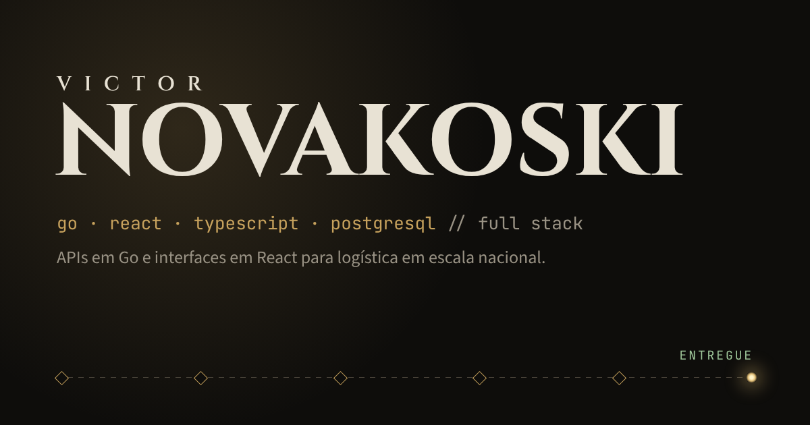

# Victor Novakoski · Portfólio



Portfólio de Victor Novakoski, desenvolvedor full stack (Go, React, TypeScript e PostgreSQL).

**No ar:** https://portifolio-victor-novakoski.vercel.app

O tema é a "Forja do Caçador": a tela de título tem um caçador com chapéu e lanterna (o chapéu é a primeira peça de um cosplay real e dá para arremessar), cada desafio técnico é uma luta curta contra um chefe e o mini game Caça-bugs fecha a visita antes do contato. Quem só quer ler tem "Ler sem lutar", e tudo funciona com teclado e com movimento reduzido.

## O que tem no site

- Projetos: Rastreia, Panda Cooking (com uma demo da busca por trigramas) e o jogo Revelação, mais dois estudos
- Desafios técnicos como lutas contra chefes: cada acerto revela o risco, a solução e o resultado
- Experiência, habilidades e um Sobre com o que faço fora do código
- Mini game Caça-bugs, carregado só quando alguém clica em jogar
- Contato e currículo em PDF

## Stack

React 19, TypeScript e Vite, com CSS puro e canvas 2D (sem framework de UI, motor de jogo nem biblioteca de animação). As animações respeitam `prefers-reduced-motion`, e o botão Pausar do cabeçalho para todas.

## Rodando localmente

```bash
yarn install
yarn dev        # http://localhost:5173
yarn lint
yarn build      # checa os tipos e gera dist/
```

## Deploy

Pensado para a Vercel. O `vercel.json` manda qualquer rota para o `index.html` (rotas desconhecidas mostram a página 404 do app). O endereço usado no canonical e nas tags de compartilhamento vem de `VERCEL_PROJECT_PRODUCTION_URL`, ou de `SITE_URL` se for definido.

## Decisões principais

- Conteúdo primeiro: nome, cargo, stack e currículo aparecem na primeira tela do celular, e todo jogo tem um atalho para quem só quer ler.
- A lógica do canvas, das lutas e do mini game fica em módulos TypeScript imperativos; o React cuida da estrutura e do texto.
- O mini game só baixa quando alguém pede para jogar.
- Quem volta vê só "Continuar em <seção>", sem horário nem tempo da visita anterior.

O porquê de cada uma está em [docs/decisoes/](docs/decisoes/), e o mapa dos docs em [docs/INDEX.md](docs/INDEX.md).

## Estrutura

Visão geral das pastas e dos fluxos em [docs/ARCHITECTURE.md](docs/ARCHITECTURE.md). Produto e design em [docs/PRD.md](docs/PRD.md) e [docs/DESIGN.md](docs/DESIGN.md).
