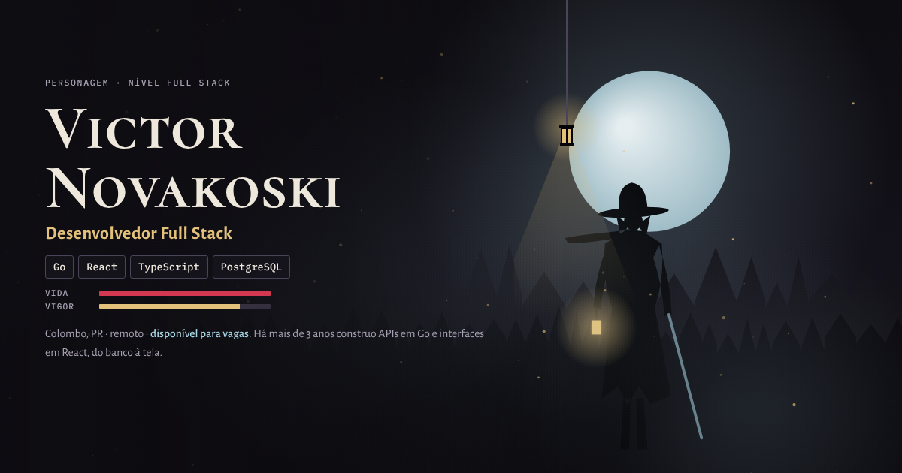

# Victor Novakoski · Portfólio



Portfólio de Victor Novakoski, desenvolvedor full stack (Go, React, TypeScript e PostgreSQL).

O tema é a "Forja do Caçador": a tela de título tem um caçador com chapéu e lanterna (o chapéu é a primeira peça de um cosplay real e dá para arremessar), cada desafio técnico é uma luta curta contra um chefe e o mini game Caça-bugs fecha a visita antes do contato. Quem só quer ler tem "Ler sem lutar", e tudo funciona com teclado e com movimento reduzido.

## O que tem no site

- Projetos: Rastreia e Panda Cooking (com uma demo da busca por trigramas), mais dois estudos
- Desafios técnicos como lutas contra chefes: cada acerto revela o risco, a solução e o resultado
- Experiência, habilidades e um Sobre com o que faço fora do código
- Mini game Caça-bugs, carregado só quando alguém clica em jogar
- Contato e currículo em PDF

## Stack

React 19, TypeScript e Vite, com CSS puro e canvas 2D (sem framework de UI, motor de jogo nem biblioteca de animação). As animações respeitam `prefers-reduced-motion`, e o botão Pausar do cabeçalho para todas.

## Rodando localmente

```bash
yarn install
yarn dev        # http://localhost:5173
yarn lint
yarn build      # checa os tipos e gera dist/
```

## Deploy

Pensado para a Vercel. O `vercel.json` manda qualquer rota para o `index.html` (rotas desconhecidas mostram a página 404 do app). O endereço usado no canonical e nas tags de compartilhamento vem de `VERCEL_PROJECT_PRODUCTION_URL`, ou de `SITE_URL` se for definido.

## Estrutura

```
src/
  data/        conteúdo do site (perfil, projetos, chefes, experiência, habilidades, seções)
  components/  uma seção por arquivo
  scene/       canvas da tela de título (céu, chapéu e lanterna)
  game/        lógica das lutas e o mini game (caca-bugs/, num chunk separado)
  lib/         pausa global, armazenamento seguro, trigramas e utilitários
  styles/      forja.css, o tema
```
